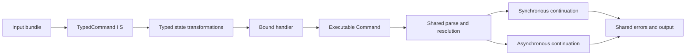

# Typed commands and async execution

Status: Implemented.

## Requirements

Handlers must receive the inputs and state declared for their command, with
compile-time type checks. Inputs can be borrowed, non-Clone Rust values. The
change must preserve existing parsing, configuration, sources, plugins, help,
completions, and injected runtimes. Async handlers must borrow inputs across
awaits and use the application's executor.

## Decision

`Command::inputs` registers a sealed input bundle and keeps its type until
`.action` or `.action_async` binds the handler. Single inputs and nested tuples
work without macros. Callbacks receive borrowed values and a `Scope` for output,
metadata, and sources. Inputs and state arrive as parameters rather than through
dynamic lookup.

Clone a global flag bundle to register it at the CLI root and in each command.
Each command registers the inputs its handler uses, regardless of runtime flag
propagation.

Typed derivations consume state `S` and return state `T`. Tuples or application
structs retain earlier values. Each invocation owns its state and drops it on
failure or cancellation. State can contain `Rc` and other non-Send values.
Closure captures remain `Send + Sync`, so command definitions can be shared.
State must own its data; callbacks can read borrowed inputs alongside it.

Async callbacks use native async closures and boxed local futures. They can
borrow context and hold non-Send values across awaits. Each continuation runs
at most once. Sync and async execution share preparation and result handling.
Filesystem access, configuration, prompts, and stdio preparation stay synchronous.
Tokio is used by tests and examples; Fujo requires no executor.

Dynamic synchronous middleware wrapping async work fails before execution hooks
or middleware run. Use `middleware_async` for that combination. Async middleware
can wrap synchronous work, and synchronous derives work in either execution mode.
A synchronous runner rejects async commands before execution hooks and derives.
Help, version, and completions remain available through synchronous runners.

## Alternatives and consequences

Unique handle IDs can improve runtime lookup but cannot prove that a command
registered an input or produced a state value. The dynamic API remains available
for applications that accept runtime checks.

A builder that accumulates a heterogeneous list through repeated `.flag()` calls
would retain more of the existing syntax. Selecting arbitrary list elements would
require more traits and harder diagnostics. Input bundles make the handler's
parameters explicit. Named structs extend this model in ADR 0003.

Implicit state accumulation would need indexed products or generated field names.
Owned state transformations let applications choose which values to retain.

Send futures would exclude local state and require more bounds on lending async
closures. Local futures can be awaited directly or run in a local task set.
They cannot use an executor's Send-only spawn method.

Separate async preparation would duplicate resolution logic. Shared preparation
keeps builtin priority, injected runtimes, errors, and plugin hooks consistent.

## Verification

CI runs core checks on Linux, macOS, and Windows, plus shell and PTY tests on
Linux. Reference tests compare JSON values from the pinned DreamCLI checkout
without rewriting fixtures. Rust tests cover plugin failures and cancellation.
They also check the activity-finish event emitted on drop after an action error,
which DreamCLI's capture omits.
