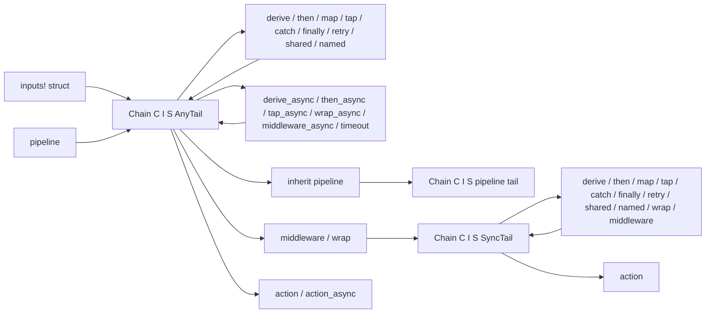

# Named inputs and typed middleware

Status: Implemented.

## Requirements

Large commands need named handler parameters. Named bundles must register inputs
and determine callback types together, support nested global flags, and keep
input readers sealed. Typed middleware needs a defined position among derivations,
clear ownership on early return, and compile-time sync and async restrictions.
`crates/fujo/examples/manifest.rs` exercises these features across two commands.

## Named bundles

`fujo::inputs!` declares an input struct and a values struct. Fields can be
handles, tuples, or other bundles. The macro implements `Bundle`, exposes field
references as a tuple, and maps the resolved tuple into the values struct.
The blanket `InputSet` implementation reads these through the private sealed
`Shape` trait. Macros neither implement nor expose that private reader trait.

Field types check the input kind, value type, and optionality at construction.
`fujo::flags!` requires every field to implement `FlagSet`, which rejects
positional arguments at declaration. Bundles implement `Clone`; values structs
implement `Copy`. A global bundle can be registered at the root and in each
command.

Fields require explicit handle types such as `Flag<u16, Required>`. A procedural
macro would add a crate and parsing dependencies. `macro_rules` supports these
declarations without adding `syn` or `quote` as workspace implementation
dependencies.

## Middleware and execution order

Typed stages run in declaration order. Middleware receives owned state and a
continuation for every later stage and the action. `next.run(state)` continues
execution and returns its result. Dropping the continuation skips those stages
and drops the state. Middleware can inspect or replace the returned result.

Internally, a stage converts a continuation over its output state into one over
its input state. Typed state therefore stays outside `Context` and needs no
runtime type map.

After synchronous `.middleware()`, the builder has a `SyncTail` marker.
Synchronous methods remain available: `then`, `derive`, `map`, `tap`, `wrap`,
`middleware`, `catch`, `finally`, `retry`, `shared`, `named`, `stages`, and `action`.
`then_async`, `derive_async`, `tap_async`, `wrap_async`, `middleware_async`,
`timeout`, `inherit`, and `action_async` require `AnyTail`.

`.middleware_async()` keeps `AnyTail`. A synchronous middleware can follow an
async derivation, because its remaining stages run synchronously within the
async invocation. The compiler rejects async stages after a synchronous
middleware. Dynamic commands check this at runtime with
`ASYNC_MIDDLEWARE_REQUIRED`.

Dynamic middleware registered on `Command` wraps the entire typed pipeline,
including derivations, and receives `Context`. Typed middleware receives `Scope`,
input values, and state, and wraps only the later typed stages.

## Reusable stages

`Derive`, `AsyncDerive`, `Middleware`, and `AsyncMiddleware` have blanket
implementations for matching closures. `then`, `then_async`, `wrap`, and
`wrap_async` accept any implementation. Structs can implement these traits across
input bundle types. Closures bind to a particular bundle whose values borrow for
a callback lifetime. `derive` and `middleware` retain closure bounds for type
inference.

There is no `Arc<T>` implementation: it would overlap with the async closure
implementation under Rust's trait coherence rules.

`tap` and `map` are derivations. `catch` and `finally` accept synchronous handlers
for either kind of continuation. All four preserve the tail marker.
`retry(n)` clones state and reruns later stages, so it requires `S: Clone`.
Internal continuations use reference-counted closures, while public `Next` and
`AsyncNext` each run at most once. `timeout(limit, sleep)` races later stages
against the application's timer and drops whichever loses.

## Inherited pipelines

`Chain<C, I, S, M>` implements both typed commands and reusable pipelines.
`C` is `Command` for a typed command and `()` for a pipeline.

`inherit` appends a pipeline after the command's declared stages. Its middleware
wraps the command's later stages and action. The command must have `()` state
and `AnyTail`. It takes the pipeline's resulting state and tail marker and
registers the pipeline's inputs.

Unchanged clones of one handle share a declaration identity and register once.
Separately constructed inputs with the same name conflict, even if their types
and visible metadata match. Their validator or decoder closures may differ.
Editing a clone gives it a new identity. Conflicts fail with `INVALID_SCHEMA`
before execution. Reuse clones of the completed handle to share a declaration.
These rules also apply to `share` and inherited flags. Propagation preserves
identity when declarations from multiple scopes combine.

## Shared pipelines

`Cli::share` and `Command::share` run a pipeline once before dispatch. They store
its state in a private `Context` slot keyed by pipeline identity, so pipelines
with the same state type remain separate.

A command reads this state through `.shared()` while its own state is `()`, or
through `Scope::shared` in a handler. Every read clones the value, which must
implement `Clone + Send` to cross the command's erased type boundary. `retry`
can rerun the read. A missing value, including one caused by middleware skipping
its continuation, produces `SHARED_STATE_MISSING`.

Shared pipelines accept flags only. Root or group registration exposes those
flags, and groups propagate them to children. A pipeline that inherits another
has input type `Inherits<I, G>`; its stages read `I`, and the combined set is
flag-only when both sets are. Shared middleware wraps its own pipeline. Inherited
middleware also wraps later command stages.

## Stage inspection

Each stage records its kind, handler type name or `.named()` label, and async
status in `StageInfo`. `Command::stages()` lists dynamic steps before typed
stages, in execution order. Parent commands contribute dynamic steps only,
because their typed stages run within their own actions.

`Command::action_info()` describes the action handler. The optional `explain`
builtin lists shared root and group stages, then command stages and the action.
It supports JSON output and executes none of those stages.

## Alternatives and consequences

Passing middleware `&S` while its continuation owns `S` would keep a borrow alive
across later derivations that consume the state. Passing owned state through the
continuation permits those transformations.

Middleware restricted to the action could not wrap later derivations, such as
the manifest example's fingerprinting. Declaration-order stages support both.

A tail marker adds one type parameter and catches invalid sync and async
combinations before runtime.

`describe`, `example`, and `alias` remain `Command` methods and must precede
`.inputs()`. `inherit` requires `()` state; applications must move earlier state
work into the inherited pipeline or a suitable stage. The manifest example uses
`tap` for its pre-scan check.
